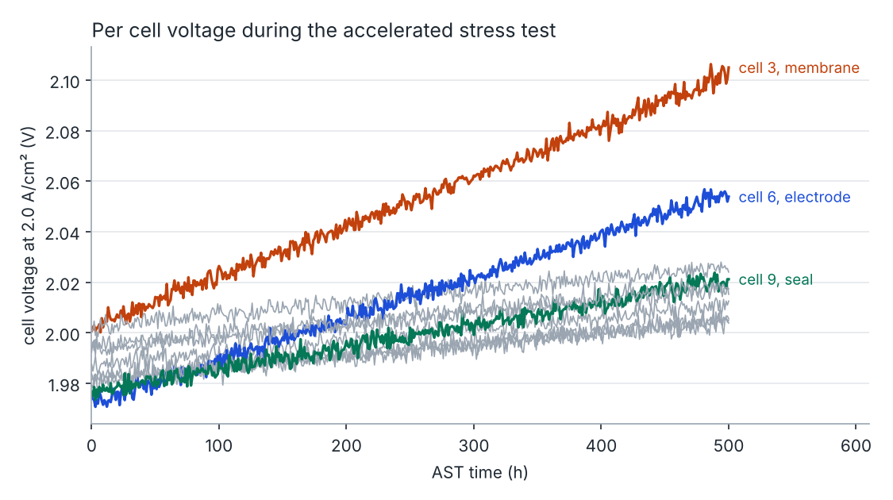
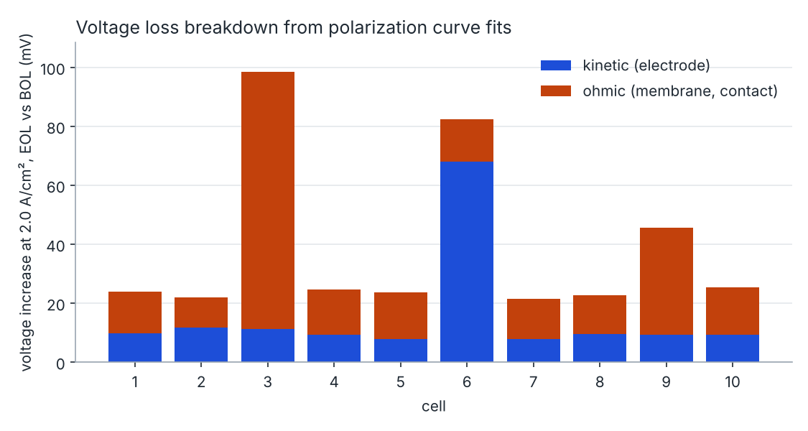
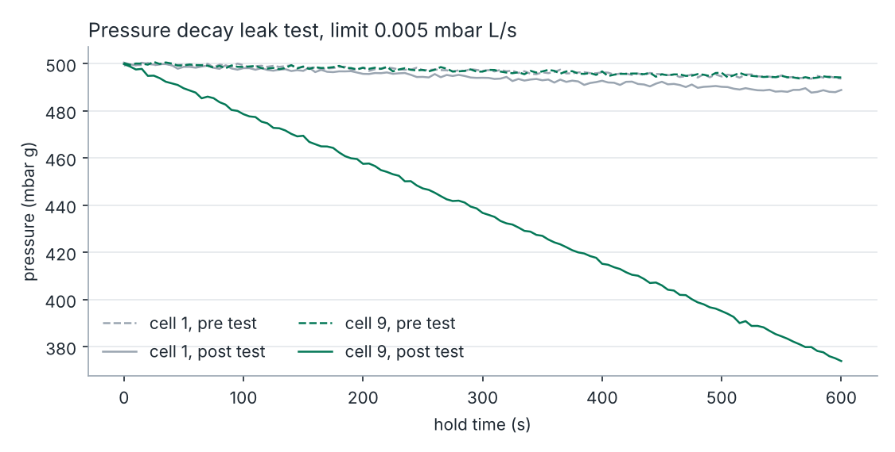
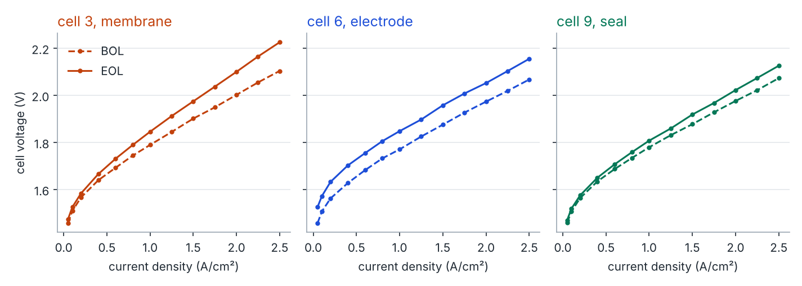

# Electrolyser stack durability testing and failure analysis

A Python toolkit for the test side of electrolyser development. It simulates a 10 cell membrane
electrolyser stack on a virtual test stand, runs an accelerated stress test (AST), and analyses
the test data to find which cell degraded and why.

> **Self initiated study, assumed data.** It is not coursework and not an employer project.
> The stack, its faults and the test stand are simulated, so every analysis result can be
> checked against a known ground truth. All parameters are assumed, illustrative textbook
> values, not data from any real product (see "Assumed data" below).



## What it does

| Step | Module | Output |
|---|---|---|
| Cell electrochemistry model: reversible voltage, activation (Butler Volmer), ohmic and mass transport losses | `cell_model.py` | polarization curve of any cell |
| Degradation of three components: membrane ASR growth, electrode catalyst loss under load cycling, seal compression set (leak rate and contact resistance) | `degradation.py` | aged cell parameters |
| Pre test and post test pressure decay leak test with a pass/fail limit | `leak_test.py` | leak rate per cell |
| Virtual test stand: square wave AST protocol, periodic polarization curves, sensor noise, safety interlock that trips on cell voltage or temperature limits | `test_stand.py` | time series test log (CSV) |
| Test data analysis: degradation rate per cell, BOL/EOL polarization curve fits, voltage loss breakdown, rule based root cause | `analysis.py` | failure analysis report |
| Process engineering view: CO2 release rate (Faraday's law) and specific energy in kWh per kg CO2 | `process.py` | process impact of degradation |
| Procedures: assemble, disassemble, pre test checklist, post test teardown inspection | `docs/procedures/` | templates |

## Run it

```bash
pip install -r requirements.txt
python run_study.py          # optional: python run_study.py <seed>
python -m pytest -q
```

Runs in a few seconds and writes figures, CSV test data and `results/failure_analysis_report.md`.

## The study

Ten cells with manufacturing scatter (±10 % exchange current, ±5 % resistance). Three faults are
injected:

| Cell | Injected fault | Mechanism |
|---|---|---|
| 3 | membrane | ASR grows 8 times faster than nominal |
| 6 | electrode | catalyst loss per load cycle 8 times faster than nominal |
| 9 | seal | leak rate grows 20 times faster, contact resistance 6 times faster |

AST protocol: 0.2 ↔ 2.0 A/cm², 60 s per level, 500 h (15,000 load cycles), polarization curves
at 0, 250 and 500 h. Safety limits: 1.2 to 2.4 V per cell, 70 °C.

### Results (seed 7)

* Root cause found correctly for **10 of 10 cells**, and for 10 of 10 cells in each of 20 seeded
  runs (seeds 1 to 20).
* Fitted loss components agree with the injected ground truth to within **6.7 mV** in the worst
  of those 20 runs (ohmic and kinetic, at 2 A/cm²).
* Degradation rate at 2 A/cm²: about 47 µV/h for healthy cells, 199 µV/h for the membrane fault,
  166 µV/h for the electrode fault, 89 µV/h for the seal fault.
* The seal fault cell fails the post test leak test at 1.05e-2 mbar L/s against a limit of
  5e-3, while passing the pre test check.
* Stack specific energy rises from 1.345 to 1.371 kWh per kg CO2 (+2.0 %) over the AST, assuming
  one electron per CO2 released and 90 % Faradaic efficiency.





## Assumed data

* Cell model: reversible voltage 1.23 V, 60 °C, charge transfer coefficient 0.5, exchange current
  density 1e-3 A/cm², membrane ASR 0.10 and contact ASR 0.05 ohm cm², mass transport coefficient
  0.03 V, limiting current 3.5 A/cm², active area 100 cm².
* Degradation rates, fault multipliers, leak test volume, noise levels, limits and the AST protocol
  as set in the code (`degradation.py`, `leak_test.py`, `test_stand.py`, `run_study.py`).
* Process view: one electron per CO2 released, 90 % Faradaic efficiency.

## How the root cause is decided

1. Post test leak rate above the limit → **seal**. Checked first, because a seal that loses
   compression also raises the contact resistance and would otherwise look like a membrane fault.
2. Ohmic loss increase above 3 times the stack median → **membrane** (or contact).
3. Kinetic loss increase above 3 times the stack median → **electrode**.
4. Otherwise → nominal ageing.

A data based root cause is a hypothesis. It is confirmed at teardown with
`docs/procedures/post_test_teardown_inspection.md`.

## Limitations

* Synthetic data from a simple lumped model; no spatial effects, no gas crossover, no thermal model.
* A polarization curve cannot separate membrane ASR from contact ASR. Impedance spectroscopy would.
* The limiting current is held fixed in the fits. Fitting it as well (`fit_ilim=True`) lets it
  trade off against the ASR and the ohmic error grows to about 16 mV.
* The procedures are templates from public practice and have not been used on hardware.

## Layout

```
src/stacktest/      model, degradation, leak test, test stand, analysis, process
run_study.py        end to end study
tests/              pytest unit tests
docs/procedures/    assembly, disassembly, pre test checklist, teardown inspection
results/            figures, CSV test data, failure analysis report (generated)
```

MIT licence.
